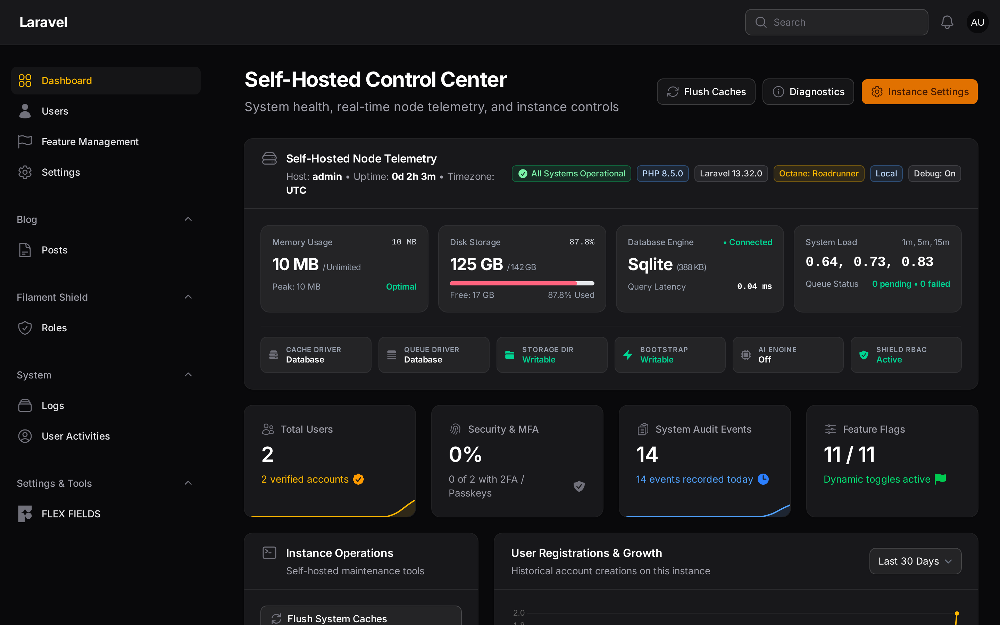
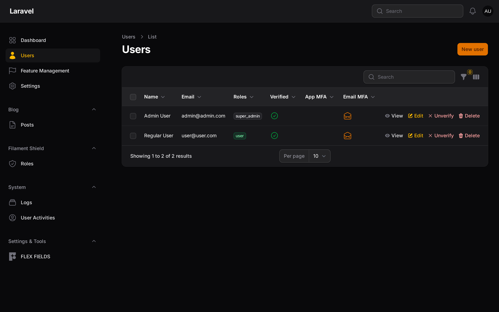
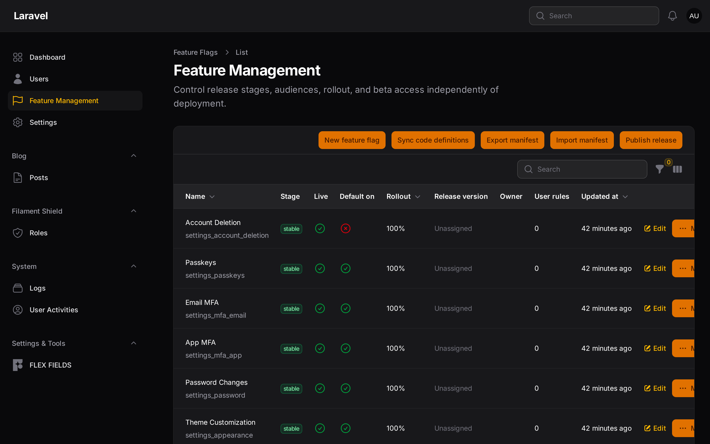
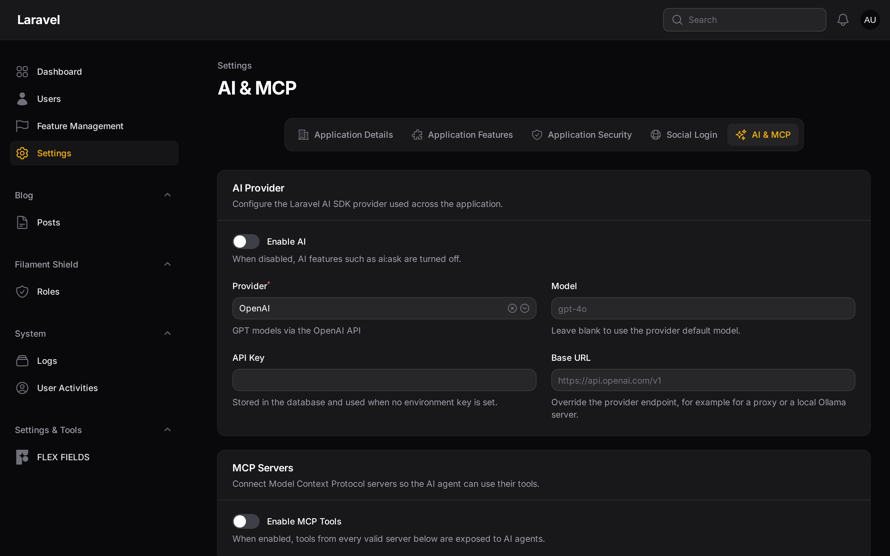
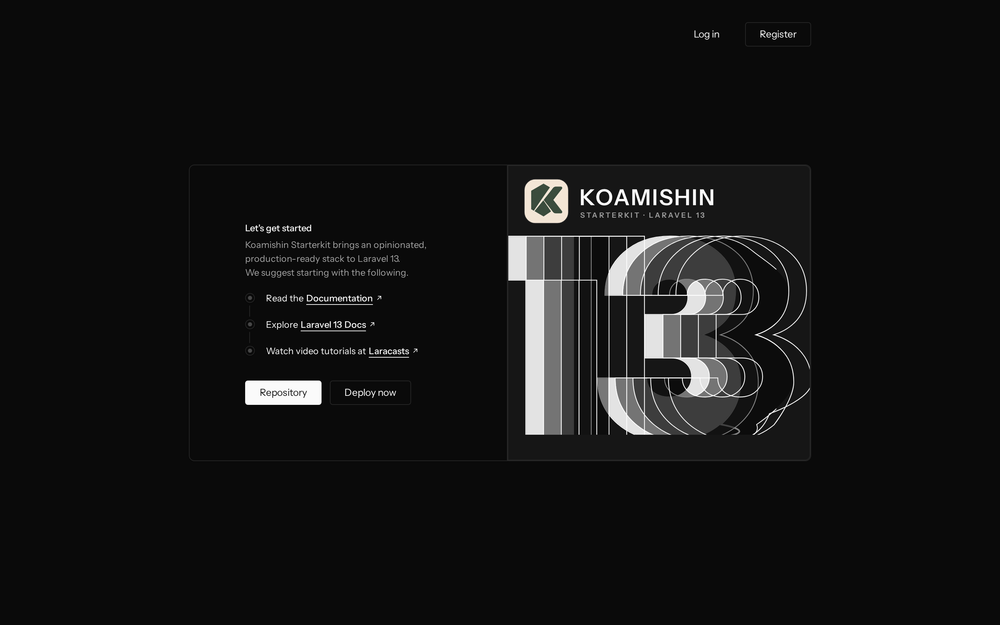
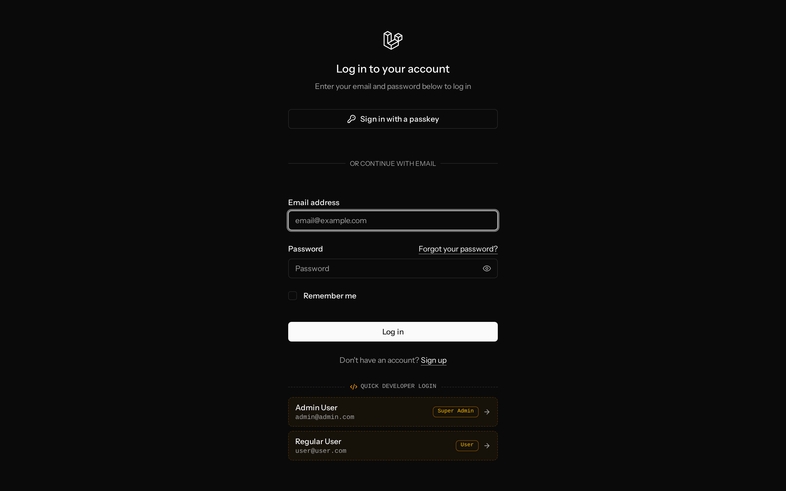
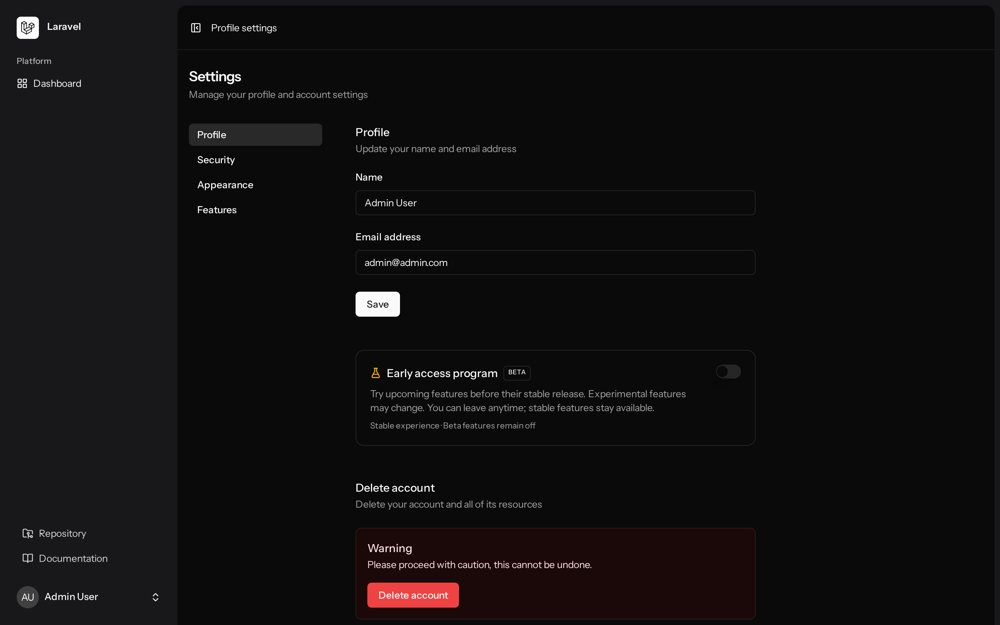

<div align="center">
  <a href="https://github.com/koamishin/KoamiStarterKit">
    
  </a>

  <h1 align="center">Koamishin Starterkit</h1>

  <p align="center">
    <strong>The Opinionated Laravel 13 + React 19 Starter Kit for Modern Artisans</strong>
  </p>

  <p align="center">
    <a href="https://laravel.com"></a>
    <a href="https://react.dev"></a>
    <a href="https://inertiajs.com"></a>
    <a href="https://filamentphp.com"></a>
    <a href="https://tailwindcss.com"></a>
    <a href="https://ui.shadcn.com"></a>
  </p>

  <br/>

  <p align="center">
    
  </p>
</div>

<br/>

## 🚀 Why This Exists?

Building modern full-stack web applications repeatedly hits identical friction points:

- Setting up complete authentication, two-factor auth (2FA), passkeys, and email verification
- Configuring a production-grade admin panel with telemetry, audit trails, and role management
- Connecting and switching AI providers and external Model Context Protocol (MCP) servers
- Managing progressive feature releases, beta cohorts, and canary rollouts
- Configuring build tools, linters, Wayfinder typed routes, and CI/CD pipelines

**Koamishin Starterkit bundles everything out-of-the-box.** One command, zero friction, and you are immediately shipping application features.

---

## 📸 Application Showcase

### 1. Self-Hosted Control Center (Admin Dashboard)
Real-time node telemetry, resource meters (RAM, Disk, CPU Load), database query latency, maintenance operations, and live spatie activity stream.

<p align="center">
  
</p>

---

### 2. User & Identity Management
User directory with metric overview cards, quick status filter tabs (`Super Admins`, `Verified`, `Unverified`, `MFA Protected`), avatar styling, role badges, impersonation, and verification action toggles.

<p align="center">
  
</p>

---

### 3. Feature Flag Lifecycle & Beta Distribution
Fine-grained feature management with release stages (`Draft`, `Beta`, `Stable`, `Archived`), percentage rollouts, user rules, revision history, and portable JSON manifest import/export.

<p align="center">
  
</p>

---

### 4. AI & Model Context Protocol (MCP) Settings
Dynamic runtime configuration for 10+ LLM providers (OpenAI, Anthropic, Gemini, Groq, xAI, DeepSeek, Ollama, OpenRouter) and custom Model Context Protocol (MCP) server wiring.

<p align="center">
  
</p>

---

### 5. Frontend & Authentication Hub
React 19 + Inertia.js v3 + Tailwind CSS v4 welcome experience with dark mode support, developer quick-login shortcuts in local environment, passkeys, and user security management.

| Modern Landing Experience | Developer Quick Login |
| :---: | :---: |
|  |  |

| User Security & Profile Hub |
| :---: |
|  |

---

## ✨ Core Highlights

- **🔐 Full Authentication**: Fortify authentication backend supporting login, registration, password confirmation, two-factor auth (App TOTP, Email OTP), passkeys (WebAuthn), and profile management.
- **⚡ Developer Quick Login**: One-click developer authentication on `/login` during local development (`APP_ENV=local`). Gated strictly to 404 in staging and production.
- **🤖 Laravel AI SDK & MCP**: Integrated `laravel/ai` and `laravel/mcp` configurable from the Filament admin panel without editing `.env`.
- **🚩 Progressive Feature Management**: Self-hosted Pennant release engine supporting lifecycle stages, user cohort targeting, beta opt-ins, and emergency kill switches.
- **🎛️ Control Center & System Telemetry**: Self-hosted node health meters, server uptime, cache flush controls, and safe maintenance mode toggling where admins retain access.
- **👥 Roles & Shield RBAC**: Pre-configured Spatie Permissions and Filament Shield with auto-enforced resource policies.
- **📦 Modular Architecture**: Powered by `nwidart/laravel-modules` for cleanly separated domains, routes, and Filament resources (includes reference `Blog` module).
- **🎨 40+ Shadcn UI Components**: Radix primitives, accessible forms, alerts, dialogs, drawers, and customizable theme palettes.
- **🛣️ Type-Safe Wayfinder Routing**: Automatically generated TypeScript helpers for Laravel routes and controller actions.
- **⚡ High Performance**: Optimized for Laravel Octane, FrankenPHP, RoadRunner, and Vite Plus.

---

## 🏁 Getting Started

### Prerequisites

- PHP 8.4 or 8.5
- Composer
- Node.js 20+ & NPM / Bun

### Installation

```bash
composer create-project koamishin/koamistarterkit my-app
cd my-app
```

Or with Laravel installer:

```bash
laravel new my-app --using=koamishin/koamistarterkit
```

### ⚙️ Setup Wizard

Personalize your application metadata, Docker registry, and repository settings:

```bash
php artisan setup:starter-kit
```

Or run scripted/unattended:

```bash
php artisan setup:starter-kit \
  --github=my-org \
  --name=my-app \
  --author="Jane Doe" \
  --email=jane@example.com \
  --docker \
  --registry=ghcr \
  --install \
  --force
```

### Running Locally

```bash
composer run dev
```

Runs the Laravel backend, Octane/artisan server, and Vite development server concurrently.

Default test accounts (populated via database seeder):
- **Super Admin**: `admin@admin.com` / `password`
- **Regular User**: `user@user.com` / `password`

---

## 🛠️ Testing & Code Quality

```bash
# Run unit and feature test suites
php artisan test --compact

# Format PHP code with Laravel Pint
vendor/bin/pint --dirty --format agent

# Build frontend assets
npm run build
```

---

## 📄 License

Distributed under the MIT License. See [LICENSE](LICENSE) for details.

<div align="center">
  <p>Built with ❤️ by <a href="https://github.com/koamishin">Koamishin</a></p>
</div>
